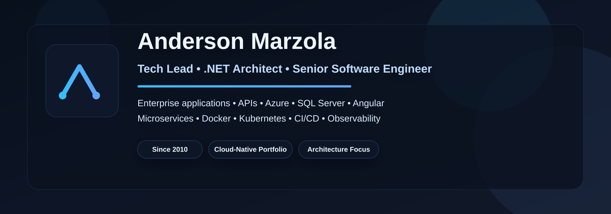

  

    

      Portfolio • Architecture • Technical Leadership
      <h1>Anderson Marzola</h1>
      <h2>Tech Lead • .NET Architect • Senior Software Engineer</h2>
      

        I build enterprise systems, APIs and cloud-native solutions with strong emphasis on
        <strong>.NET</strong>, <strong>Azure</strong>, <strong>SQL Server</strong>,
        <strong>Angular</strong>, <strong>Docker</strong>, <strong>Kubernetes</strong>,
        <strong>CI/CD</strong> and <strong>observability</strong>.
      

      

        My goal is to bridge business needs and robust engineering through scalable architecture,
        practical leadership and production-ready delivery.
      

      

        <a class="btn btn-primary" href="https://github.com/ajmarzola">View GitHub</a>
        <a class="btn" href="cv/Anderson_Marzola_CV.pdf">Download CV</a>
        <a class="btn" href="#featured-projects">Featured Projects</a>
        <a class="btn" href="#contact">Contact</a>
      

    

    

      

        
Experience

        
15+ years

        
Building software since 2010

      

      

        
Primary Focus

        
.NET & Azure

        
Architecture, APIs and cloud delivery

      

      

        
Current Positioning

        
Tech Lead

        
Hands-on leadership and solution design

      

      

        
Portfolio Direction

        
Cloud-Native

        
Microservices, Kubernetes and observability

      

    

  

## Executive Summary

  

    Software Engineer since <strong>2010</strong>, with more than <strong>15 years of experience</strong>
    delivering enterprise applications, backend services, integrations and business-critical systems.
  

  

    My current positioning is centered on <strong>technical leadership</strong>,
    <strong>solution architecture</strong> and <strong>cloud-native engineering</strong>.
    I work across backend design, API strategy, modernization initiatives, DevOps enablement and scalable deployment models.
  

  

    I am also pursuing a <strong>Postgraduate Degree in .NET Systems Architecture at FIAP</strong>,
    where I develop practical portfolio projects involving microservices, event-driven workflows,
    container orchestration, monitoring and end-to-end architecture design.
  

## Core Stack

  

  

## Value Proposition

  
<strong>Architecture</strong> APIs, distributed systems and scalable solution design.

  
<strong>Leadership</strong> Hands-on technical guidance, code review and delivery quality.

  
<strong>Cloud</strong> Azure, Docker, Kubernetes, CI/CD and platform readiness.

  
<strong>Execution</strong> Enterprise focus with practical engineering and maintainability.

## Featured Projects {#featured-projects}

  

    <h3>FIAP Cloud Games</h3>
    
Cloud-native architecture project • microservices • observability

    

      A postgraduate flagship project designed to demonstrate a production-oriented platform
      with distributed services, event-driven communication and operational visibility.
    

    <ul>
      <li>Microservices architecture with service separation by business capability</li>
      <li>Containerized services with Docker</li>
      <li>Kubernetes orchestration and scalable deployment model</li>
      <li>Prometheus and Grafana for monitoring and observability</li>
    </ul>
    
<strong>Stack:</strong> .NET • Azure • Docker • Kubernetes • Messaging • Monitoring

    <a class="project-link" href="https://github.com/ajmarzola?tab=repositories">Open repositories →</a>
  

  

    <h3>AgroSolutions</h3>
    
Distributed platform • environment strategy • infrastructure maturity

    

      A modular architecture proposal focused on service decomposition, deployment organization,
      observability and technical consistency across environments.
    

    <ul>
      <li>Service-oriented decomposition and clean project organization</li>
      <li>Container-first structure for local and cloud scenarios</li>
      <li>Deployment overlays and environment-specific configuration</li>
      <li>Monitoring and telemetry as part of the architecture baseline</li>
    </ul>
    
<strong>Stack:</strong> .NET • Docker • Kubernetes • YAML • Monitoring • DevOps

    <a class="project-link" href="https://github.com/ajmarzola?tab=repositories">Open repositories →</a>
  

  

    <h3>Digital Certificate Signing Solution</h3>
    
Document signing • browser extension flow • backend integration

    

      Architecture proposal for secure PDF signing using Brazilian digital certificates,
      combining user workflow, API integration and storage strategy.
    

    <ul>
      <li>Certificate selection and signing flow design</li>
      <li>Secure backend integration for PDF handling</li>
      <li>Practical product-oriented approach for enterprise use cases</li>
      <li>Cloud storage compatibility for signed documents</li>
    </ul>
    
<strong>Stack:</strong> .NET • Web API • PDF • Certificates • Azure Blob Storage

  

  

    <h3>News Aggregator App</h3>
    
API integrations • mobile concept • personalized content delivery

    

      A cloud-based architecture concept combining personalized news aggregation,
      external integrations, notification strategy and shareable content generation.
    

    <ul>
      <li>Interest-based aggregation with custom API strategy</li>
      <li>Mobile application concept with .NET MAUI</li>
      <li>External feeds and content integration model</li>
      <li>Push notifications and shareable card generation planning</li>
    </ul>
    
<strong>Stack:</strong> .NET MAUI • ASP.NET Core • Azure • Cosmos DB • Notification Hubs

  

## GitHub Presence

  

    <h3>Contribution Activity</h3>
    
Live graph to reinforce active engineering work and public portfolio visibility.

    
  

  

    <h3>GitHub Metrics</h3>
    
Useful visual signals for recruiters, peers and technical stakeholders.

    
      
    
  

## Experience & Education

  

    <h3>Professional Snapshot</h3>
    

      <strong>Senior Systems Analyst / Tech Lead</strong> 
      FIESP – Federation of Industries of the State of São Paulo
      

        Development and evolution of enterprise software, backend services, integrations,
        architecture improvements, technical collaboration and delivery support for strategic systems.
      

    

    

      <strong>Software Engineering Journey Since 2010</strong>
      

        Experience across web systems, desktop solutions, APIs, database design,
        integration services and modernization initiatives.
      

    

  

  

    <h3>Education</h3>
    

      <strong>Postgraduate Degree in .NET Systems Architecture</strong> 
      FIAP
    

    

      <strong>Technologist Degree in Data Processing</strong> 
      FATEC
    

    

      <strong>Professional Direction</strong>
      

        Focused on architecture, technical leadership, cloud engineering and
        high-value enterprise solution delivery.
      

    

  

## CV & Contact {#contact}

  

    This page is designed to work as the professional entry point to my GitHub presence.
    Add the final links below to complete the experience.
  

  

    Replace the placeholders with your final professional e-mail, LinkedIn URL and repository-specific links.
  

  

    <strong>CV:</strong> <a href="cv/Anderson_Marzola_CV.pdf">Download PDF</a> 
    <strong>GitHub:</strong> <a href="https://github.com/ajmarzola">github.com/ajmarzola</a> 
    <strong>LinkedIn:</strong> add your final LinkedIn URL here 
    <strong>Email:</strong> add your professional e-mail here
  

  Designed to present a curated, senior-level portfolio with an executive dark aesthetic and a clear architecture-focused positioning.

